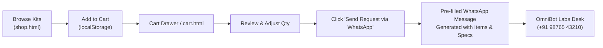

# OmniBot Labs — Flagship Digital Platform & Product Ecosystem

A world-class, production-ready digital platform and product ecosystem for **OmniBot Labs** (Hyderabad, India). Built as a high-performance, zero-build-step static architecture optimized for 100% offline local viewing and seamless GitHub Pages deployment (`omnibotlabs.com`).

---

## Strategic Architecture & Business Model

OmniBot Labs bridges two core pillars:
1. **Commercial Engineering Powerhouse**: High-quality solderless educational hardware kits, school innovation lab setups, college engineering sprints, and certified maker trainer network.
2. **Social Impact / NGO Mission (Project Udaan)**: Subsidized hardware kits for under-resourced schools, open-source hardware repositories, and rural educator fellowships.

### Key Constraints & Design Principles
- **Zero Login Friction**: The public web platform requires no accounts, passwords, or authentication hurdles. Every rung of the curriculum, hardware spec sheet, project story, and impact report is immediately accessible.
- **Request-Based Commerce (No Payment Gateway)**: Bypasses unnecessary payment gateway friction (no Razorpay/Stripe/UPI checkouts). Customers add items to a persistent client-side cart, review quantities, and launch a pre-formatted request directly to the OmniBot Labs Hyderabad engineering desk via WhatsApp.
- **WhatsApp Centralized Configuration**: The business WhatsApp target is configured in one single place: `OmnibotData.config.WHATSAPP_BUSINESS_NUMBER` in [`js/data.js`](file:///d:/Omnibot%20Labs/Omnibot%20Labs%20Website/js/data.js).
- **Client-Side Persistence**: Cart items and theme preference (Dark/Light mode) persist across pages and reloads using browser `localStorage`.
- **Site-Wide Categorized Search**: Instant index search across Products, Programs, Projects, Trainers, Ladder Rungs, and Social Impact stories with `Cmd/Ctrl + K` or header icon trigger.

---

## Platform Sitemap & Page Architecture

```
Omnibot Labs Website/
├── index.html              # Flagship Homepage (Workbench hero, signature moments, kits preview, social impact, trainers)
│
├── Commerce & Request Flow
│   ├── shop.html           # Hardware kits catalog with category filter & Add to Cart
│   ├── shop-detail.html    # Deep-dive kit specs, in-the-box bill of materials, learning outcomes, project possibilities
│   └── cart.html           # Dedicated request review page with quantity steppers & WhatsApp submit flow
│
├── Curriculum & Pedagogy
│   ├── ladder.html         # The 10-Grade Builder's Ladder (Grades 3–12) interactive rung explorer
│   ├── curriculum.html     # Full grade-by-grade syllabi across Foundations, Bridge, Engineering & Frontier bands
│   ├── capstones.html      # 10 annual public capstones showcase
│   ├── threads.html        # 7 core skill threads with interactive spiral visualization
│   └── philosophy.html     # 6 pedagogical rules we never break
│
├── Programs & Institutional
│   ├── programs.html       # Programs catalog (Bootcamps, school sprints, college labs)
│   ├── program-detail.html # Deep-dive 4-phase program modules and hardware stack
│   ├── schools.html        # Turnkey school innovation labs & institutional partnerships
│   └── book-demo.html      # Free 45-minute hands-on demo booking with slot reservation
│
├── Editorial & Showcase
│   ├── projects.html       # Physical artifact project showcase with category filters
│   ├── project-detail.html # Comprehensive build story (Problem, Idea, Stack, Build, Test, Impact)
│   ├── trainers.html       # Builder & mentor directory ("What does this person help you build?")
│   ├── trainer-detail.html # In-depth trainer profile, hardware specialties, and programs led
│   ├── gallery.html        # Workshop floor photo gallery with lightbox modal
│   └── impact.html         # Project Udaan, open hardware repos, educator fellowships & CSR impact
│   └── impact-detail.html  # In-depth social impact initiative detail
│
├── Corporate & Legal
│   ├── about.html          # Founding story, Hyderabad workbench, engineering ethos
│   ├── contact.html        # Hyderabad lab bench address, direct WhatsApp desk, contact form
│   ├── faq.html            # Categorized accordion FAQ (Curriculum, Kits, Schools, Impact)
│   ├── privacy.html        # Privacy policy (Zero tracking, localStorage only)
│   ├── terms.html          # Educational terms of service & open hardware licenses
│   ├── shipping-returns.html# Pan-India dispatch, delivery timelines & replacement policy
│   ├── signup.html         # Clean zero-friction redirect to book-demo.html
│   └── 404.html            # Custom 404 page with odometry drift theme
│
├── Design System & Engines
│   ├── css/
│   │   └── style.css       # Full unified design system (tokens, blueprint panels, drawers, modals, responsive)
│   ├── js/
│   │   ├── data.js         # Single source of truth for Products, Programs, Ladder, Projects, Trainers, Impact, FAQs
│   │   ├── cart.js         # Client-side cart engine, drawer UI, toasts, WhatsApp URL generator
│   │   ├── search.js       # Global categorized Cmd+K modal search engine
│   │   └── main.js         # Core UI interactions, theme toggle, mobile drawer, hero canvas, spotlights
│   ├── assets/             # Brand logos (logo-dark.png, logo-light.jpeg)
│   ├── CNAME               # Custom domain configuration (omnibotlabs.com)
│   └── .nojekyll           # GitHub Pages Jekyll bypass
```

---

## Local Development & Viewing

### Direct File Execution
All paths are relative. You can open [`index.html`](file:///d:/Omnibot%20Labs/Omnibot%20Labs%20Website/index.html) directly in any modern web browser without a web server.

### Local HTTP Server (Recommended)
To test under strict HTTP protocol:
```powershell
# Using Python
python -m http.server 8080

# Or using Node
npx serve .
```
Navigate to `http://localhost:8080`.

---

## WhatsApp Request Workflow



---

## Production Deployment to GitHub Pages

1. **Initialize Git** in this directory if not already done:
   ```bash
   git init
   git add .
   git commit -m "Deploy OmniBot Labs flagship website and product ecosystem"
   git branch -M main
   git remote add origin https://github.com/<org-or-username>/<repo-name>.git
   git push -u origin main
   ```
2. **Configure GitHub Pages**:
   - In GitHub repository settings: **Pages** → **Source** → **Deploy from a branch** (`main` / root).
   - Ensure `CNAME` points to `omnibotlabs.com` with HTTPS enabled.
3. The `.nojekyll` file ensures GitHub Pages serves all directories without Jekyll preprocessing.

---

© 2026 OmniBot Labs. Learn it. Build it. Test it. Show it. Use it to create impact.
